<div align="center">



<br/>


</div>

A simple command-line habit tracker written in Python. No dependencies, just Python 3.8+.

## 🚀 Usage

```bash
python habit.py add "drink water"     # add a habit
python habit.py done "drink water"    # mark it done today
python habit.py list                  # show all habits with streaks
python habit.py remove "drink water"  # delete a habit
```

### Example output

```text
[x] drink water               streak:   3  total: 5
[ ] read                      streak:   0  total: 2
```

## 💾 Data

Data is stored in `~/.habits.json`. Set the `HABITS_FILE` environment variable to use another location.

## 🧪 Tests

```bash
python -m unittest test_habit.py
```
